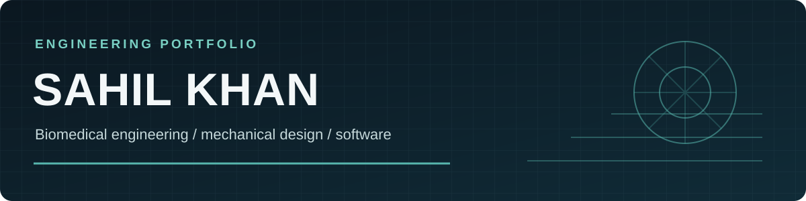

### Biomedical engineering · mechanical design · engineering software

I turn technical constraints into prototypes, simulations, and tools that can be tested and improved.

[Portfolio](https://sahil-khan-engineering-portfolio.skhan101905.chatgpt.site/) · [Engineering résumé](https://sahil-khan-engineering-portfolio.skhan101905.chatgpt.site/resumes/sahil-khan-engineering-resume.pdf) · [LinkedIn](https://www.linkedin.com/in/sahil-k2/) · [Email](mailto:sk4363@drexel.edu)

## About me

I'm Sahil Khan, a biomedical engineering student at Drexel University. I work across prosthetic devices, spacecraft mechanisms, CAD automation, simulation, and signal processing. I like projects where the design decisions and the evidence behind them are both visible.

## Selected work

| Project | What I worked on |
| --- | --- |
| [Tetra-chiral prosthetic lattice](https://sahil-khan-engineering-portfolio.skhan101905.chatgpt.site/projects/tetra-chiral-prosthetic-lattice) | Designed three lattice configurations, ran FEA, fabricated test articles, and compared compression behavior with a standard cylinder. |
| [Modular prosthetic hand](https://sahil-khan-engineering-portfolio.skhan101905.chatgpt.site/projects/emg-prosthetic-hand) | Led the architecture for a 3D-printed hand with swappable end effectors, embedded motor control, and EMG intent processing. |
| [Negative-pressure isolation helmet](https://sahil-khan-engineering-portfolio.skhan101905.chatgpt.site/projects/negative-pressure-helmet) | Connected requirements to a Simulink model, a low-cost prototype, and a bench verification plan. |
| [Engineering portfolio](https://github.com/Sahil101905/portfolio) | Built a React and TypeScript site to present engineering case studies and explain the work behind each outcome. [View site ↗](https://sahil-khan-engineering-portfolio.skhan101905.chatgpt.site/) |
| [PlasmaFlow / CareConnect](https://github.com/Sahil101905/careconnect) | Explored a voice-assisted plasma donor scheduling concept for a healthcare innovation challenge; the repository documents the proposed product and architecture. |

## What I'm working with

`SolidWorks` · `Siemens NX` · `MATLAB / Simulink` · `Python` · `FEA` · `EMG signal processing` · `TypeScript / React`

I'm also developing an educational wearable sensing platform that brings together PPG, motion sensing, embedded firmware, BLE, and validation against a reference. It is still in the design and build stage.

Some engineering work is private or organization-sensitive. The linked case studies use public results and sanitized descriptions.
